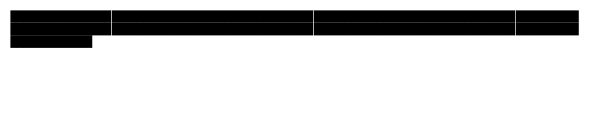
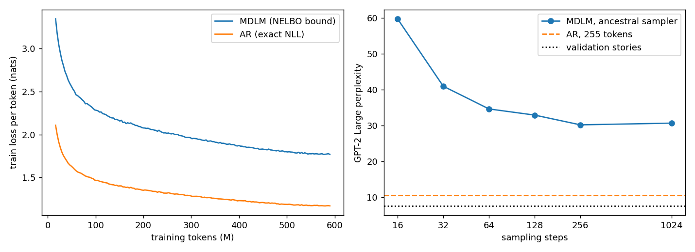

# Masked diffusion vs autoregressive language models

A masked diffusion language model (MDLM, Sahoo et al., 2024) written from scratch in PyTorch and trained on TinyStories, compared against a GPT style autoregressive (AR) model. Both use the same transformer, tokenizer, data, number of training tokens and optimizer settings. All the code is in [`mdlm.ipynb`](mdlm.ipynb), and the trained weights are on [Hugging Face](https://huggingface.co/shantanu-das/mdlm-tinystories).



## Setup

Each model has 31.1M parameters excluding embeddings (width 512, 10 layers, 8 heads) and was trained on 590M tokens with context length 256 and an 8192 token BPE vocabulary. The two were trained at the same time on a Kaggle T4 x2, one per GPU (MDLM 2.7 hours, AR 3.4 hours).

## Results

Validation perplexity is 3.25 for AR and at most 5.77 for MDLM. The AR number is exact. The MDLM number comes from the training objective (the NELBO), which is an upper bound, so the true gap may be smaller.

Sample quality, from 256 unconditional samples per row:

| | GPT-2 Large perplexity | Unigram entropy | Forward passes | Seconds per sample |
|---|---|---|---|---|
| Real validation stories | 7.6 | 4.11 | | |
| AR | 10.6 | 4.14 | 255 | 1.90 |
| MDLM, 16 steps | 59.8 | 4.25 | 16 | 0.15 |
| MDLM, 32 steps | 41.0 | 4.24 | 32 | 0.27 |
| MDLM, 64 steps | 34.6 | 4.24 | 63 | 0.53 |
| MDLM, 128 steps | 32.9 | 4.20 | 111 | 0.96 |
| MDLM, 256 steps | 30.2 | 4.20 | 162 | 1.48 |
| MDLM, 1024 steps | 30.7 | 4.21 | 225 | 2.23 |

GPT-2 Large perplexity measures how natural the samples look to a larger model (lower is better). Unigram entropy guards against repetitive text, which can also score well. Timing is batch 1 on a T4.



Main observations:

- AR is better on both likelihood and sample quality at this scale. Its samples come closest to the real stories, and their entropy is almost the same.
- MDLM samples improve with more steps until about 256 steps, which is roughly one token revealed per step. Beyond that there is no further gain.
- MDLM uses fewer forward passes than steps at high step counts. When a step reveals no token, the input is unchanged, so the previous output is reused.
- MDLM is faster with few steps (0.53 s at 64 steps against 1.90 s for AR), but its samples are noticeably worse. They stay on topic, but have more broken sentences and characters whose names change partway through.
- MDLM can fill in text between a given start and end with no extra training. AR can only continue from the start.

## How it works

**Forward process.** Each token is replaced by a `<mask>` token independently with probability $t$, for $t$ between 0 and 1.

**Model.** A bidirectional transformer (RoPE, RMSNorm, SwiGLU, tied embeddings) sees the masked sequence and predicts the original token at every masked position. It is not given $t$, since the number of masks already tells it how noisy the input is.

**Loss.** Cross entropy on the masked positions, weighted by $1/t$ and averaged over the sequence. This weighting makes the loss an upper bound on the negative log likelihood.

**Sampling.** Start from a fully masked sequence and step $t$ down from 1 to 0. Going from $t$ to $s$, each masked position is revealed with probability $(t - s)/t$, using a token sampled from the model. Revealed tokens never change. Sampling is done in float64, because float32 rounding makes samples less diverse (Zheng et al., 2024). A prompt or an infilling task is handled by fixing the known tokens.

**AR baseline.** The same transformer with a causal mask and next token prediction, sampled with a KV cache at temperature 1.

**Checks.** Before any long training, the notebook asserts that the masking rate matches $t$, the loss at initialization is about $\log V$, the sampler never changes a revealed token and leaves no masks, the KV cache matches a full forward pass, and both models can memorize a few sequences.

## Samples

The first non-empty sample from each model at the evaluation seed, not cherry-picked.

**AR**

> Once upon a time, there was a little dog named Max. Max liked to plan fun things to do. He would help his friends if they had a miserable day.
>
> One day, Max was walking down the street when he saw a big cat. The cat looked miserable. Max tried to make the cat happy. He wagged his tail and showed the cat his favorite toy.
>
> Max knew the cat was miserable. He wanted to be friends with the cat. So, Max walked up to the cat and gave it a hug. The cat felt better and they both played together. From that day on, Max and the cat were best friends.

**MDLM, 256 steps**

> Once upon a time, there was a brave cat named Tim. Tim loved to play with his friends. One day, he decided to joke his best friend, Bella. "Lucy look where you are!" said Tim.
>
> Bella looked behind a tree. Tim tried to pinch on her back, but she didn't listen. He thought of the best monster ever to help her. So, he gave Lucy a big hug. Then, he bravely poked Bella's face many times. Bella was sad but then she said, "Thank you for smiling at me, Tim!"
>
> From that day on, Tim always helped Lucy in the land. They loved taking turns to trick them. It's not to be kind and stronger, because their jokes and warmth can't be the king's times ever again.

## Running it

```
pip install -r requirements.txt
```

Then set `MODE` in the first code cell of the notebook:

- `demo` downloads the weights and opens a Gradio app on CPU. Give it the start of a story, or a start and an end to fill in the middle.
- `smoke` runs the whole pipeline on CPU with a tiny model, including all the checks, in a few minutes.
- `prep`, `train` and `eval` are the Kaggle runs that build the data, train both models and produce the results above.

## Limitations

- Small models on a simple dataset. The gap could look different at larger scale or on harder text.
- One training run per model, so there are no error bars.
- MDLM's likelihood is only a bound, and GPT-2 Large perplexity depends on the judge model.

## References

- Sahoo et al., 2024. Simple and Effective Masked Diffusion Language Models.
- Shi et al., 2024. Simplified and Generalized Masked Diffusion for Discrete Data.
- Zheng et al., 2024. Masked Diffusion Models are Secretly Time-Agnostic Masked Models and Exploit Inaccurate Categorical Sampling.
- Eldan and Li, 2023. TinyStories: How Small Can Language Models Be and Still Speak Coherent English?
